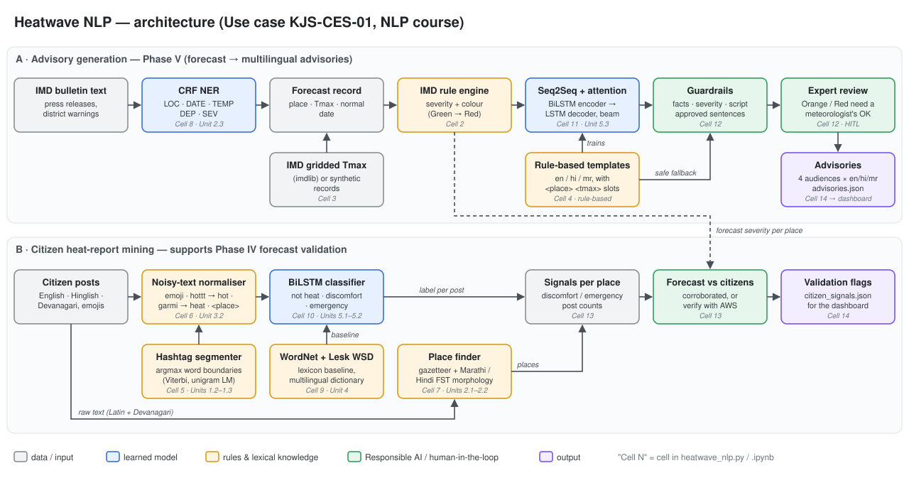

# Heatwave NLP Toolkit

**Use case KJS-CES-01 · Climate Intelligence for Heatwave Monitoring, Prediction and Early Warning**
**Course: Natural Language Processing**

This project builds the NLP layer of the heatwave early-warning system using only techniques from the NLP syllabus. It does two jobs:

1. **Advisory generation (Phase V of the use case).** It reads an IMD-style bulletin, extracts *where / how hot / when*, applies IMD's heatwave criteria, and generates **advisories for 4 audiences (citizens, farmers, health departments, authorities) in English, Hindi and Marathi**. Every advisory passes automatic fact checks, and Orange/Red warnings wait for a meteorologist's approval.
2. **Citizen heat-report mining (supports Phase IV validation).** It reads noisy social-media posts (English, Hinglish, Devanagari, emojis, hashtags), finds the posts that are about heat and the places they mention, and flags places where what citizens report and what the forecast says disagree.

Everything is in **one file**, [heatwave_nlp.py](heatwave_nlp.py), split into 15 cells. The same code is also in [heatwave_nlp.ipynb](heatwave_nlp.ipynb) for Google Colab.

---

## 1. Quick start

### Google Colab (recommended)
Pick any one of these:

- **Upload the notebook:** colab.research.google.com → *File → Upload notebook* → `heatwave_nlp.ipynb` → *Runtime → Run all*.
- **Paste everything into one cell:** open a new notebook, paste all of `heatwave_nlp.py` into a single cell and run it.
- **Paste cell by cell:** the file is split by `# %%` markers. Paste each block into its own cell and run them **top to bottom**, because every cell uses names defined by the cells above it.

The first cell installs `sklearn-crfsuite`, the only package Colab doesn't already have. A full run takes **about 2–5 minutes on CPU**. A GPU speeds it up, but you don't need one.

### Local
```bash
pip install -r requirements.txt
python heatwave_nlp.py                 # full run (2–5 min on a laptop CPU)
python run_checks.py                   # self-check: 41 tests (edge cases, guardrails, review)
HEATWAVE_FAST=1 python heatwave_nlp.py # quick smoke test, fewer epochs
```
Results are written to `outputs/`.

### Editing the code
`heatwave_nlp.py` is the source of truth. After you change it, rebuild the notebook:
```bash
python make_notebook.py
```

---

## 2. Folder structure

```
Heatwave_NLP/
├── heatwave_nlp.py        ← all the code (15 cells, # %% markers)
├── heatwave_nlp.ipynb     ← the same code as a Colab notebook (generated)
├── make_notebook.py       ← rebuilds the .ipynb from the .py
├── run_checks.py          ← self-check: runs the notebook + 41 edge-case tests
├── requirements.txt
├── docs/
│   └── architecture.svg   ← architecture diagram
├── presentation/
│   ├── Heatwave_NLP_Presentation.pptx  ← 6-slide deck on the Somaiya template (with speaker notes)
│   ├── build_deck.js      ← regenerates the deck (pptxgenjs)
│   └── assets/            ← Somaiya logos cropped from the template
└── outputs/               ← created when you run it
    ├── advisories.json        generated advisories + check results + review status
    ├── citizen_signals.json   heat reports per place
    ├── ner_crf.pkl            trained CRF NER model
    ├── seq2seq_advisory.pt    trained Seq2Seq model + vocabularies
    └── post_classifier.pt     trained BiLSTM classifier + vocabulary
```

---

## 3. Architecture



**Lane A: advisory generation**

```
IMD bulletin ─► CRF NER ─► forecast record ─► IMD rule engine ─► Seq2Seq + attention
                 (place, Tmax, date)            (severity, colour)        │
                                                                          ▼
          advisories.json ◄─ expert review ◄─ guardrails ◄── fill in real values
                                                 ▲
                         rule-based templates ───┘ (training data + safe fallback)
```

**Lane B: citizen report mining**

```
posts ─► normalise (emoji, hottt→hot, garmi→heat, #hashtag segmentation) ─► BiLSTM ─► label
  └────► place finder (gazetteer + Marathi/Hindi morphology) ─────────────────────► place
                                    signals per place  vs  forecast severity ─► "corroborated" / "verify with AWS"
```

**Design decisions:**

| Decision | Why |
|---|---|
| **Severity comes from IMD rules, not from a neural network** | Warnings must be auditable. The rule engine (Cell 2) follows IMD's published criteria; the neural model only writes the text. |
| **The model writes `<place>`, `<tmax>`, `<date>`, not the real values (delexicalisation)** | The model cannot invent or mistype a temperature. Real values are filled in afterwards from the structured record. |
| **Every output is checked before release** | Place, Tmax, departure, severity wording, script and language are all verified, and every sentence must come from the approved advisory library. If a check fails, the advisory is replaced by the deterministic template. |
| **Orange/Red warnings need human approval** | Required by the use case (§13 *Human-in-the-Loop: High*). |

---

## 4. Syllabus mapping

| Cell | Component | Syllabus unit | Technique |
|---|---|---|---|
| 2 | IMD heatwave rule engine | (domain) | Threshold rules: Tmax ≥ 40/37/30 °C; departure ≥ 4.5 / 6.5 °C; Tmax ≥ 45 / 47 °C |
| 4 | Multilingual advisory templates | *3.3 (design idea only)* | Slot-filling templates; baseline and fallback for the neural model. The system is a hybrid of rules and probabilistic models, which is the idea of Unit 3.3, applied to generation rather than parsing |
| 5 | Hashtag word segmentation | **1.2** word boundary detection, **1.3** argmax computations | Unigram LM + Viterbi dynamic programming |
| 6 | Noisy text normaliser | **3.2** robust processing of noisy web text | Emoji mapping, elongation fixing, Hinglish lexicon, number/place masking |
| 7 | Marathi/Hindi morphological analyser | **2.1** morphology of Indian languages, **2.2** FSM morphology | Two-layer finite-state analyser: suffix stripping + restoring the oblique stem |
| 8 | Named Entity Recognition | **2.3** shallow parsing, NER, MaxEnt, random fields | Linear-chain CRF with hand-made features |
| 9 | Lexical knowledge | **4.1** WordNet, **4.2** multilingual dictionaries, **4.3** WSD | WordNet synonym expansion, sense filtering, Lesk, en→hi→mr dictionary |
| 10 | Citizen-post classifier | **5.1** RNNs, **5.2** training/tuning RNNs, hidden state | BiLSTM + max-pooling, word dropout, gradient clipping, hidden-state probe |
| 11 | Advisory generator | **5.3** Seq2Seq, advanced Seq2Seq, Seq2Seq use case | BiLSTM encoder, LSTM decoder, Luong attention, teacher forcing, greedy and beam search |
| 12 | Guardrails + review | Responsible AI (use case §13) | Fact checks, approved-sentence grounding, human-in-the-loop |
| 13 | End-to-end pipeline | all | Bulletin → advisories; posts → validation signals |

**Optional extensions:** the project deliberately focuses on the units above. These other units are not used, but could be added later if wanted.

| Unit | Topic | How it could be added |
|---|---|---|
| 1.1, 1.4 | Biology of speech; HMM speech recognition | Voice advisories / farmer helpline (see section 12) |
| 3.1 | Parsing theories and algorithms | CKY or Earley parser over a small grammar of bulletin sentences |
| 3.3 | Scope and attachment ambiguity | PP-attachment in bulletins, e.g. *"heatwave over Vidarbha on 18 May"*: what does "on 18 May" attach to? |
| 4.3 (part) | Semantic roles, metaphors, coreference | Metaphor detection (*"Nagpur is an oven"* is already in the posts); coreference (*"Nagpur recorded 46 °C. **It** was the hottest…"*) |

---

## 5. Cell-by-cell walkthrough

### Cell 0–1 · Setup and configuration
Installs `sklearn-crfsuite` if it's missing, fixes the random seeds and creates `outputs/`. The switches you can change are explained in [section 8](#8-configuration-switches).

### Cell 2 · IMD heatwave criteria
`classify_heatwave(tmax, normal, terrain)` returns `NORMAL / WATCH / HEATWAVE / SEVERE` and the departure from normal.
- A heatwave is only considered once Tmax reaches the terrain threshold: **40 °C plains, 37 °C coastal, 30 °C hilly**.
- **HEATWAVE:** departure 4.5–6.4 °C, *or* Tmax ≥ 45 °C (plains).
- **SEVERE:** departure ≥ 6.5 °C, *or* Tmax ≥ 47 °C (plains).
- **WATCH (Yellow) is a band this project defines** (departure ≥ 2.5 °C), not an IMD criterion.

`PLACES` lists 26 stations with their state, region, terrain, coordinates, approximate normal May Tmax, and Hindi/Marathi spellings.

### Cell 3 · Datasets
- **Forecast records:** by default, 1,000 synthetic records balanced across the 4 severity levels (rejection sampling makes sure the IMD rules really give each target level). Set `USE_REAL_IMD_DATA = True` to download **IMD Pune gridded Tmax** (the GRD files named in the use case) with `imdlib` instead.
- **Citizen posts:** 3 classes (`NOT_HEAT`, `HEAT_DISCOMFORT`, `HEAT_EMERGENCY`) with added noise (elongated words, capitals, emojis, hashtags). `NOT_HEAT` deliberately includes confusing senses such as *"Miami Heat won"*, *"hot deals"*, *"this song is fire"* and *"spicy food is too hot"*. **The last 3 templates of each class are used only for testing**, so the test set contains phrasings the model has never seen.

### Cell 4 · Rule-based multilingual templates
For each severity × language there are two headline variants, and for each audience × severity band × language there are two action sentences. WATCH adds a "stay alert" line and SEVERE adds "call 108". Templates contain placeholders:

```
Orange alert : heatwave conditions likely in <place> on <date> . Maximum temperature <tmax> °C , <dep> °C above normal .
```

`relexicalize()` fills in the real values, using Devanagari place names and month names for Hindi and Marathi (*नागपूर, 18 मे*). These templates serve three purposes: the **baseline**, the **training data** for the Seq2Seq model, and the **safe fallback**.

### Cell 5 · Word boundary detection (hashtags)
`#heatwavealertnagpur` → `['heatwave', 'alert', 'nagpur']`.
Of all ways to split the string, choose the one that maximises Σ log P(word), using dynamic programming:
`best[i] = max_j best[j] + log P(text[j:i])`.
This is the same argmax-over-paths idea a speech recogniser (HMM + Viterbi) uses to place word boundaries in continuous audio.

### Cell 6 · Noisy text normalisation
`"NAGPUR is burninggg 🥵 47°C!! #heatwavealert"` → `['<place>', 'is', 'burning', 'hot', '<num>', 'degrees', 'heatwave', 'alert']`

The order of the steps matters:
1. Map emojis to words before the non-letter characters are removed.
2. Segment hashtags before punctuation is stripped.
3. Normalise `°C` before replacing numbers with `<num>`.
4. Mask places last.

Masking places as `<place>` lets the classifier handle cities it never saw in training.

### Cell 7 · Morphology (Marathi / Hindi)
Marathi attaches case markers to nouns, and stems often change before a suffix:

| Word | Layer 1: strip suffix | Layer 2: restore stem | Meaning |
|---|---|---|---|
| नागपूरमध्ये | नागपूर + मध्ये | नागपूर | in Nagpur |
| पुण्यात | पुण्य + ात | **पुणे** (्य → े) | in Pune |
| उष्णतेची | उष्णते + ची | **उष्णता** (े → ा) | of heat |
| जिलों (hi) | जिल + ों | **जिला** (+ा) | districts (oblique) |

When several analyses are possible, the analyser prefers the one whose stem is in its lexicon. `find_places()` uses this to find *Pune* in "पुण्यात आज ऊन खूप आहे".

### Cell 8 · CRF Named Entity Recognition
- **Entities:** `LOC`, `DATE`, `TEMP` (observed temperature), `DEP` (departure from normal), `SEV` (heatwave / severe heatwave).
- **Features:** the word, its prefix and suffix, shape (`Xx`, `d.d`), whether it's a number in the temperature range, whether it's a month name, whether it's a degree word, whether it's in the gazetteer, and the same features for the ±2 neighbouring words.
- **Honest evaluation:** test sentences use **10 locations the model never saw**, and half of them use **new sentence templates**.
- **Gazetteer dropout:** the gazetteer feature is hidden in half of the training sentences. Without this, the CRF just memorises the place list and finds only **~8%** of unseen places. With it, it finds **~90%**. This is a good illustration of over-reliance on one feature.
- The cell prints the strongest learned features and transitions, so you can see what the CRF learned (e.g. `B-TEMP → I-TEMP`, `°C` → `I-TEMP`).

### Cell 9 · WordNet, WSD, multilingual dictionary
- **Naive WordNet expansion** of "heat/hot" brings in unrelated senses (*estrus, ignite, live…*). **Sense filtering** keeps only synsets whose definition is about weather or temperature.
- Prints the hypernym path *heat_wave → wave → weather → atmospheric_phenomenon*.
- **Lesk WSD** on "Miami Heat won…" vs "the heat wave raised the temperature…" picks the same (wrong) sense for both. This shows why plain gloss overlap is weak and motivates the trained classifier in Cell 10.
- A small **English → Hindi → Marathi** dictionary (लू / उष्णतेची लाट, उष्माघात, …). For full coverage, use IndoWordNet (`pyiwn`).

### Cell 10 · BiLSTM post classifier
`Embedding → BiLSTM → max-pool over time → Linear`. Training tricks from Unit 5.2:
- **gradient clipping**, which guards against exploding gradients;
- **word dropout** (15% of words replaced by `<unk>`), which helps with unseen vocabulary;
- dropout before the output layer.

The model is compared with the **WordNet keyword baseline**. The **hidden-state probe** prints P(emergency) after each word, which shows the "meta meaning" of the hidden state as the model's belief builds up:

```
my uncle                          P(emergency)=0.28
my uncle fainted                  P(emergency)=0.53
my uncle fainted in the heat      P(emergency)=0.84
... near <place> bus stand        P(emergency)=1.00
```

Devanagari posts go through a keyword lexicon matched on morphological stems, because the BiLSTM only knows English and Hinglish.

### Cell 11 · Seq2Seq with attention
```
Encoder input : SEV_HEATWAVE AUD_FARMER LANG_hi TER_plains TMAX_46 DEP_5.0
Decoder output: नारंगी अलर्ट : <date> को <place> में लू चलने की संभावना । ...
```
- **Encoder:** BiLSTM. Its final states are passed through a learned bridge to start the decoder.
- **Decoder:** LSTM with **Luong (general) attention** over the encoder states, trained with **teacher forcing**.
- **Decoding:** greedy (argmax at each step) and **beam search** (beam 3, length-normalised).
- **Evaluation:** multi-reference BLEU (each input has 4 valid advisories) and exact match.
- Prints which input token each output word paid most attention to.

### Cell 12 · Guardrails and human-in-the-loop
`verify_advisory()` checks the following before release:

| Check | Catches |
|---|---|
| `place_mentioned`, `tmax_correct`, `departure_correct` | wrong or missing facts |
| `severity_matches_rules` | e.g. "Orange alert" on a day the IMD rules call Red |
| `correct_script`, `correct_language` | Hindi text in a Marathi advisory, English in Devanagari |
| `no_unfilled_slots` | leftover `<tmax>` / `<unk>` |
| `only_approved_sentences`, `has_headline_and_action`, `no_repetition` | loops, truncated sentences, farmer advice sent to hospitals |

`review_advisory()` then does three things:
- replaces failed outputs with the rule-based template;
- auto-approves NORMAL/WATCH advisories;
- marks HEATWAVE/SEVERE advisories as `PENDING_EXPERT_APPROVAL`. With `APPROVAL_MODE = "interactive"` it asks **once per warning** (place + date + severity), and your answer applies to all 12 versions of that warning (4 audiences × 3 languages).

### Cell 13 · End-to-end pipeline
1. **NER** on a sample bulletin (it mentions *Chandrapur*, a place the NER never saw in training).
2. **Records and severity:** e.g. Chandrapur 47.6 °C → SEVERE (Tmax ≥ 47 °C), Nagpur 46.1 °C → HEATWAVE (≥ 45 °C).
3. **Advisories:** 4 audiences × 3 languages per place, then checks, then review.
4. **Citizen signals:** classify the posts, find their places, and compare with the forecast. If citizens report emergencies where the forecast shows NORMAL/WATCH, or for a place with no forecast, the place is flagged *"verify with AWS"*. This links to the weather-station (AWS) validation in Phase IV.

### Cell 14 · Save
Writes the JSON outputs and the trained models to `outputs/`. In Colab, download them with
`from google.colab import files; files.download("outputs/advisories.json")`.

---

## 6. Results (one full CPU run, seed 42, synthetic data)

| Component | Test setting | Result |
|---|---|---|
| CRF NER | unseen places, half unseen phrasings | micro F1 **0.94**: TEMP/DEP/SEV ≈ 1.00, DATE 0.997, **LOC 0.85** |
| Keyword baseline (WordNet) | unseen post phrasings | accuracy **0.78**: flags "Miami Heat", "hot deals" etc. as heat |
| BiLSTM classifier | unseen post phrasings | accuracy **0.90**: most errors are discomfort posts labelled emergency |
| Seq2Seq advisory generator | unseen records | BLEU **100**, exact match **100%** (see note below) |
| Guardrails | 480 generated advisories | **100%** pass |

Sample output (Chandrapur, 47.6 °C → SEVERE, citizen advisory):

> **en:** Severe heatwave warning for Chandrapur on 18 May: temperature may touch 47.6 °C, 4.6 °C above normal. Stay indoors during peak afternoon hours, wear light cotton clothes and cover your head when outside. Call 108 for heat-stroke emergencies.
>
> **hi:** चंद्रपुर में 18 मई को भीषण लू की चेतावनी, तापमान 47.6 °C तक पहुँच सकता है, सामान्य से 4.6 °C अधिक। दोपहर 12 बजे से 3 बजे के बीच बाहर निकलने से बचें, प्यास न लगने पर भी पानी पिएँ और ओआरएस, लस्सी या छाछ लें। लू लगने की आपात स्थिति में 108 पर कॉल करें।
>
> **mr:** चंद्रपूर येथे 18 मे रोजी तीव्र उष्णतेच्या लाटेचा इशारा, तापमान 47.6 °C पर्यंत जाऊ शकते, सामान्यपेक्षा 4.6 °C जास्त. दुपारच्या वेळी घरातच राहा, हलके सुती कपडे घाला आणि बाहेर जाताना डोके झाका. उष्माघाताच्या आपत्कालीन स्थितीत 108 वर संपर्क करा.

**How to read these numbers:**
- **Seq2Seq BLEU 100 does *not* mean the model is perfect.** The training targets come from a small template library, so the model only has to learn which template goes with which input, and it does so completely.
- With `SEQ2SEQ_INCLUDE_SEVERITY = False` the model still scored 100% in our run: it learned IMD's thresholds from the Tmax/departure bins alone. That works because the 0.5 °C departure bins and 1 °C Tmax bins line up exactly with IMD's cut-offs (4.5, 6.5, 45, 47 °C). Experiment 3 in [section 9](#9-lab-experiment-ideas) breaks that alignment.
- With fewer epochs (`HEATWAVE_FAST=1`) the Seq2Seq produces loops and advice meant for the wrong audience. The guardrails catch these and fall back to templates, which shows why the guardrails exist.
- All data is synthetic, so the numbers measure how well the method works, not how well it would perform in the field. Real bulletins and real posts will score lower.
- These numbers come from a CPU run. On a GPU, or with other library versions, the neural-model numbers can differ slightly.

**Run on real IMD data** (`USE_REAL_IMD_DATA = True`, 2019–2024 gridded Tmax, records from April–June 2024):
- 2,366 records for all 26 places: 2,052 NORMAL, 187 WATCH, 106 HEATWAVE, 21 SEVERE.
- SEVERE days fall in May–June 2024, mostly in the north-west (Sri Ganganagar, Delhi, Jaipur, Jhansi). The hottest day is **Sri Ganganagar, 47.7 °C on 27 May 2024**, which matches the record heatwave of that period.
- The Seq2Seq trained on these records still passed 480/480 checks.

---

## 7. Data: synthetic vs real

| Data | Default | Real source |
|---|---|---|
| Forecast / observed Tmax | synthetic, balanced across severities | IMD Pune gridded daily Tmax (`USE_REAL_IMD_DATA = True`, via `imdlib`) |
| Normals | approximate May normals in `PLACES` | IMD 1991–2020 station normals. With `imdlib`, the code uses the day-of-year mean over the downloaded years. |
| Bulletin sentences (NER) | generated from 20 templates | IMD press releases and district-wise warnings (tag 200–300 sentences by hand) |
| Citizen posts | generated from 39 templates + noise | X/Twitter, news comments (needs ethics clearance and anonymisation) |
| Advisory wording | written for this project | NDMA heat action plan guidelines and IMD impact-based advisories, to be reviewed by domain experts |

**Real IMD download:** the first run downloads about 8.4 MB (six yearly `.GRD` files) into `imd_data/`. The IMD server is often slow, so each year is retried up to 3 times. Files that are already complete are reused on later runs. If the download still fails, the notebook says so and falls back to synthetic data.

**Approximations to replace for real use:** the place → IMD-region mapping, the normal temperatures, the WATCH band and the simplified colour codes. IMD's real colour codes also depend on how long the heat lasts.

---

## 8. Configuration switches

All switches are in Cell 1:

| Switch | Default | Effect |
|---|---|---|
| `USE_REAL_IMD_DATA` | `False` | Download IMD gridded Tmax with `imdlib` (needs internet; falls back to synthetic data on failure) |
| `APPROVAL_MODE` | `"auto"` | `"interactive"` asks you to approve each Orange/Red warning with `input()` |
| `SEQ2SEQ_INCLUDE_SEVERITY` | `True` | `False` hides the severity token, so the Seq2Seq must work out severity from the Tmax/departure bins |
| `FAST_MODE` (env `HEATWAVE_FAST=1`) | off | Fewer records and epochs, for a quick check |

---

## 9. Lab experiment ideas

These can be used as LAB CA or IA tasks:

| # | Experiment | Unit | What students observe |
|---|---|---|---|
| 1 | Remove gazetteer dropout in Cell 8 | 2.3 | LOC recall on unseen places drops from ~0.9 to ~0.08: the model memorised the list |
| 2 | Add a feature (e.g. "previous word is *at/over/in*") and compare the CRF weights | 2.3 | How MaxEnt/CRF feature engineering works |
| 3 | Set `SEQ2SEQ_INCLUDE_SEVERITY = False` (learns IMD thresholds perfectly), then change the departure bin in `src_tokens()` from 0.5 °C to 1 °C | 5.3 | The 4.5 / 6.5 °C thresholds now fall *inside* a bin, so the model cannot always tell HEATWAVE from WATCH. Count the `severity_matches_rules` failures the guardrail catches |
| 4 | Greedy vs beam size 1/3/5; teacher forcing vs scheduled sampling | 5.3 | Effect of the decoding strategy |
| 5 | Turn off word dropout or gradient clipping in Cell 10 | 5.2 | Generalisation to unseen phrasings; training stability |
| 6 | Swap the LSTM for a GRU or vanilla RNN | 5.1 | Vanishing gradients on longer posts |
| 7 | Extend the Marathi suffix list; measure place-finding on 50 real Marathi posts | 2.1–2.2 | Morphological richness of Indian languages |
| 8 | Replace Lesk with the classifier for "heat" WSD; compare on 100 tweets | 4.3 | Knowledge-based vs learned WSD |
| 9 | Hand-tag 200 real IMD bulletin sentences; retrain and evaluate the CRF | 2.3, 3.2 | How performance changes from synthetic to real text |

---

## 10. What has been verified

| Check | How | Result |
|---|---|---|
| Runs in a fresh environment | New Python 3.12 venv (Colab's version), `pip install -r requirements.txt`, full run in an empty folder | exit 0, no errors or warnings, same numbers as section 6 |
| Notebook works cell by cell | Every `.ipynb` code cell run in order in one namespace, like Colab's *Run all* | all 15 code cells OK |
| Edge cases and guardrails | `python run_checks.py`: IMD rule boundaries, invalid dates, empty/emoji/Devanagari posts, unknown places, corrupted advisories, interactive approval, model reloading | 41/41 pass |
| Real IMD data | `USE_REAL_IMD_DATA = True` with a real download from imdpune.gov.in | works (see section 6) |
| Not tested | An actual Google Colab session; a GPU | – |

---

## 11. Limitations

- **Synthetic data only by default**, so results are optimistic (see section 6).
- The Seq2Seq is a **closed-domain generator**. It can only reproduce or recombine approved sentences, and the guardrails enforce this. That suits official warnings, but it is not free text generation.
- The BiLSTM is English/Hinglish only. Devanagari posts use a keyword lexicon.
- The morphological analyser is a small teaching FST, not a full Marathi/Hindi analyser.
- Lesk WSD is shown mainly as a cautionary example.
- IMD's gridded Tmax has 1° (~100 km) cells. A cell can mix hills and plains, so hill stations like Dehradun and Shimla can be over-flagged. Use station data, or the 0.5° product, for hill and coastal places.

---

## 12. Next steps (beyond the syllabus)

- **LLM-assisted advisories** (use case Phase V): replace or augment the Seq2Seq with an LLM prompted with the structured record, and keep the same `verify_advisory()` guardrails and expert review.
- **Better translation:** AI4Bharat **IndicTrans2** for other Indian languages; **IndicNLP** for tokenisation and normalisation.
- **Voice alerts and farmer helpline** (Units 1.1, 1.4): text-to-speech of advisories; speech recognition (e.g. IndicWhisper) for spoken farmer questions.
- **Integration:** `outputs/advisories.json` can feed the advisory service or dashboard of the wider platform.

---

## 13. Course-level mapping (Part C of the use case form)

| Course | Contribution to Use Case | Relevant Topics from Syllabus | Potential Modes of Integration |
|---|---|---|---|
| Natural Language Processing | Generate stakeholder-specific heatwave advisories in English, Hindi and Marathi from forecasts, with factual checks and expert approval; extract heatwave entities (location, date, temperature, departure, severity) from IMD bulletins; mine citizen social-media posts for heat-stress signals to support forecast validation. | Unit 1.2–1.3 word boundary detection, argmax; Unit 2.1–2.3 Indian-language morphology, FSM morphology, NER, MaxEnt/CRF; Unit 3.2 robust noisy-text processing; Unit 4 WordNet, multilingual dictionaries, WSD; Unit 5 RNN/LSTM, Seq2Seq with attention | Lab experiments (CRF NER, BiLSTM post classifier, Seq2Seq advisory generator) as LAB CA; mini-project / IA on the end-to-end multilingual heatwave advisory pipeline |
